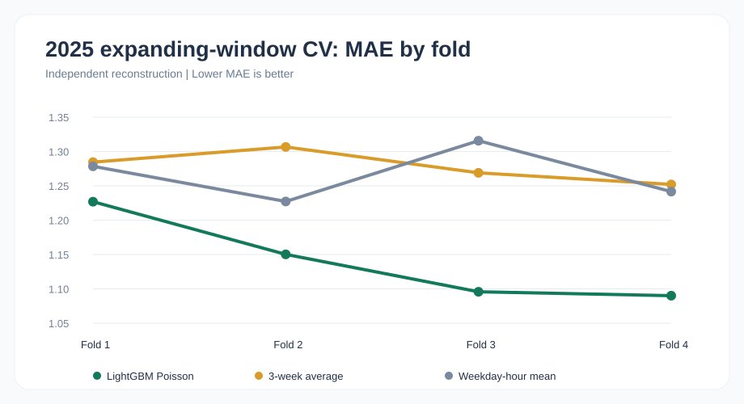
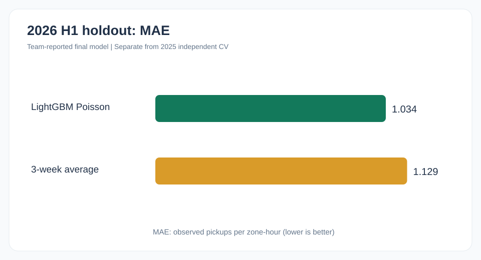

# NYC Green Taxi Demand Forecasting

**LightGBM Poisson 기반 지역별 승차 건수 예측 | 4Sight 팀 프로젝트**

NYC Green Taxi 운행 데이터를 활용해 **지역별 다음 1시간의 관측 승차 건수**를 예측하고, 그 결과를 가상 차량 배치와 영업 효율화 의사결정에 활용하는 프로젝트입니다. 예측 정확도뿐 아니라 **시간순서에 따른 검증, 기준선 비교, 지역별 수요 분포의 예측 품질**을 함께 살펴봤습니다.

- **데이터:** NYC TLC Green Taxi Trip Records, 2024년 1월~2026년 6월(월별 Parquet 30개)
- **분석 단위:** 주요 20개 승차 지역 × 시간
- **모델:** LightGBM Poisson 회귀
- **활용 목표:** 예상 승차 비율을 활용한 가상 차량 배치, 영업 효율화 대시보드 및 지도 시각화

## 프로젝트 기여도

| 구분 | 기여 및 산출물 |
| --- | --- |
| **개인 기여 — 고아름** | 승차 건수가 0 이상의 건수형 데이터라는 점에 착안해 **LightGBM Poisson 목적함수 적용을 제안**하고, **모델을 직접 구현**했습니다. |
| **4Sight 팀 공동 산출물** | 데이터 전처리·분석과 최종모형 평가, **가상 차량 배치 시나리오 구상**, **영업 효율화 대시보드 및 지도 시각화 제작**, 최종 발표를 함께 수행했습니다. |

## 핵심 평가 결과

| 평가 구분 | 지표 | LightGBM Poisson | 기준선(Baseline) |
| --- | --- | ---: | ---: |
| **2025년 독립 재현 4-Fold** | MAE 평균 ± Fold 표준편차 | **1.141 ± 0.064** | 과거 3주 평균 1.278 ± 0.023 |
| 2025년 독립 재현 4-Fold | TVD 평균 | **0.293** | 요일·시간대 평균 0.303 |
| **2026년 상반기 팀 최종모형** | MAE | **1.034** | 과거 3주 평균 1.129 |
| 2026년 상반기 팀 최종모형 | RMSE | **1.918** | 과거 3주 평균 2.136 |
| 2026년 상반기 팀 최종모형 | TVD | **0.321** | 요일·시간대 평균 0.327 |
| 2026년 상반기 팀 최종모형 | Top-5 승차 포착 비율 | **68.29%** | 요일·시간대 평균 67.34% |

2026년 팀 최종모형의 MAE는 과거 3주 평균보다 **약 8.5% 낮았으나**, 승차 비율 기반 TVD와 Top-5 지표의 개선은 제한적이었습니다.

> **평가 출처 구분:** 2025년 4-Fold는 별도로 구성한 **독립 재현 실험**이고, 2026년 상반기는 **4Sight 팀이 보고한 최종모형 평가 결과**입니다. 같은 구현을 연속 검증한 수치로 직접 비교하지 않습니다.

## 평가 결과 시각화

### 2025년 독립 재현: 4-Fold MAE 비교



[MAE 평균 ± Fold 간 표준편차 그래프](reports/figures/2025_cv_mae_mean_sd.svg)

### 2026년 팀 최종모형: 기준선 비교



[TVD 및 Top-5 승차 포착 비율 비교 그래프](reports/figures/2026_share_metrics.svg)

## 예측 결과의 운영 활용

팀에서는 예측 승차 비율을 바탕으로 **20대의 차량을 가상 배분**하는 시나리오를 구상하고, 이를 영업 효율화 대시보드와 지도 시각화로 표현했습니다.

예를 들어 **2026년 6월 1일 17시**의 예측 비율에 따른 배분 사례는 East Harlem North **28.7% → 6대**, East Harlem South **26.3% → 5대**입니다.

또한 **2026년 6월 1일 07시** East Harlem North에서는 실제 승차 **53건**에 비해 예측은 **약 28.5건**으로, 혼잡 시간대의 과소예측을 확인할 수 있습니다. [해당 날짜의 시간별 실제·예측 데이터](reports/metrics/2026_east_harlem_north_hourly.csv)

이 배치는 **실제 배차 실험이 아닌 가상 시나리오**입니다. TLC 데이터만으로는 미충족 수요나 실제 가용 차량을 알 수 없으므로, 시나리오의 Coverage Proxy 차이를 추가 승차 건수나 실현 이익으로 해석하지 않습니다.

## 독립 재현 코드 및 실행 방법

저장소에는 **2025년 Expanding Window 4-Fold 독립 재현**을 위한 전처리·학습·평가·시각화 코드를 공개했습니다.

| 단계 | 실행 파일 | 산출물 |
| --- | --- | --- |
| 1. 데이터 전처리 | [`src/prepare_data.py`](src/prepare_data.py) | 로컬 정제 데이터 및 [월별 품질 결과](reports/metrics/raw_quality_reproduced.csv) |
| 2. LightGBM 학습·평가 | [`src/run_4fold_cv.py`](src/run_4fold_cv.py) | [Fold별 지표](reports/metrics/2025_4fold_model_scores.csv), [평균·표준편차](reports/metrics/2025_4fold_mean_sd.csv) |
| 3. SVG 그래프 생성 | [`src/visualize_results.py`](src/visualize_results.py) | [시각화 파일](reports/figures/) |

### 설치 및 실행

**필수 환경:** Python 3.10 이상, Git, 패키지 설치를 위한 인터넷 연결. 아래 명령은 **Windows PowerShell 예시**입니다. 운영체제에 따라 가상환경 활성화 명령이 달라질 수 있습니다.

```powershell
git clone https://github.com/areum-hub/nyc-green-taxi-demand-forecasting.git
cd nyc-green-taxi-demand-forecasting

# 권장: 프로젝트 전용 가상환경 생성
python -m venv .venv
.\.venv\Scripts\Activate.ps1
python -m pip install -r requirements.txt
```

**원본 데이터 준비:** [NYC TLC 공식 Trip Record Data](https://www.nyc.gov/site/tlc/about/tlc-trip-record-data.page) 페이지의 **Green Taxi Trip Records**에서 `2024-01`부터 `2025-12`까지 월별 Parquet 파일 **24개**를 내려받고, 저장소 루트 아래 `data/raw/`에 다음과 같이 배치합니다. 원본 파일은 이 저장소에 포함하지 않습니다.

```text
data/
  raw/
    green_tripdata_2024-01.parquet
    ...
    green_tripdata_2025-12.parquet
```

파일명은 `green_tripdata_YYYY-MM.parquet` 형식을 권장합니다. 전처리 스크립트는 같은 월에 해당하는 파일이 2개 이상 있으면 중복 오류를 발생시킵니다.

데이터 준비 후 저장소 루트에서 순서대로 실행합니다.

```powershell
python src/prepare_data.py
python src/run_4fold_cv.py
python src/visualize_results.py
```

**실행 결과 확인:** 전처리 품질 집계는 `reports/metrics/raw_quality_reproduced.csv`, Fold별 평가 결과는 `reports/metrics/2025_4fold_model_scores.csv`, 요약 지표는 `reports/metrics/2025_4fold_mean_sd.csv`에 저장됩니다. 시각화 결과는 `reports/figures/`에서 확인할 수 있습니다.

패키지 의존성은 [`requirements.txt`](requirements.txt)에 정의되어 있으나 버전이 범위로 지정되어 있습니다. 따라서 설치 시점의 라이브러리 버전과 실행 환경에 따라 세부 수치가 달라질 수 있습니다. README의 수치는 저장된 보고 결과이며, 모든 환경에서 동일한 값이 재현된다고 보장하지 않습니다.

**데이터 관리:** 2026년 1~6월 원본 파일은 선택 사항이며 품질 집계에만 사용합니다. 2025년 독립 재현 학습·검증에는 포함하지 않습니다. 원본 Parquet와 전처리 중간 파일은 GitHub에 공개하지 않습니다.

본 프로젝트는 별도의 API Key나 환경변수 설정 없이 실행할 수 있으므로 `.env.example` 파일을 사용하지 않습니다.

**상세 안내:** [검증 방법론·학습 기간 경계](docs/methodology.md) · [2026년 팀 평가 결과](reports/metrics/2026_team_holdout_summary.csv) · [독립 재현 실험 설정](reports/metrics/methodology.json)

**데이터 출처:** [NYC Taxi & Limousine Commission — Trip Record Data](https://www.nyc.gov/site/tlc/about/tlc-trip-record-data.page)


## 프로젝트 구조

현재 GitHub에 공개된 파일을 기준으로 정리했습니다. **2025년 독립 재현 코드**와 **2026년 팀 최종모형의 보고 지표**는 구분합니다.

| 경로 | 역할 |
| --- | --- |
| [`src/prepare_data.py`](src/prepare_data.py) | NYC TLC 원본 Parquet 전처리, 유효 승차 기록 생성 및 월별 품질 집계 |
| [`src/parquet_min.py`](src/parquet_min.py) | Parquet 데이터의 필요한 열을 읽기 위한 보조 모듈 |
| [`src/run_4fold_cv.py`](src/run_4fold_cv.py) | 2024~2025년 데이터를 이용한 LightGBM Poisson **2025년 Expanding Window 4-Fold 독립 재현** 학습·평가 |
| [`src/visualize_results.py`](src/visualize_results.py) | 저장된 2025년 독립 재현·2026년 팀 평가 지표를 바탕으로 SVG 그래프 생성 |
| [`docs/methodology.md`](docs/methodology.md) | 데이터 정제, 특성 구성, 시계열 검증 및 평가 방법 설명 |
| [`reports/metrics/`](reports/metrics/) | 2025년 독립 재현 지표, 2026년 팀 보고 지표, 데이터 품질 집계 및 실험 설정 파일 |
| [`reports/figures/`](reports/figures/) | 2025년 교차검증·2026년 팀 평가 결과의 SVG 시각화 |
| [`requirements.txt`](requirements.txt) | Python 실행에 필요한 패키지 의존성 |
| [`.gitignore`](.gitignore) | 원본 데이터·중간 산출물·가상환경 등 Git 추적 제외 설정 |
| [`LICENSE`](LICENSE) | 공개한 자체 소스 코드의 MIT 라이선스 |

> **범위 안내:** 저장소의 학습·평가 스크립트는 **2025년 독립 재현 실험**용입니다. 2026년 상반기 결과는 팀의 **별도 보고 지표**로 보관하며, 해당 팀 최종모형의 원본 학습·평가 코드는 포함하지 않습니다.

## 재현 범위 및 한계

- 이 저장소의 실행 코드는 **2025년 Expanding Window 4-Fold 독립 재현 실험**을 대상으로 합니다. **2026년 상반기 팀 최종모형의 원본 학습·평가 파이프라인은 포함하지 않습니다.** 서로 다른 실험 결과를 동일한 코드로 재현한 수치로 해석하지 마세요.
- TLC 기록은 **관측된 승차 기록**이며, 미충족 수요·실제 가용 차량·재배치 비용을 직접 제공하지 않습니다. 차량 20대 배분과 영업 효율화 결과는 **가상 시나리오**로, 실제 추가 매출이나 배차 효과를 입증한 결과가 아닙니다.
- 데이터의 재배포 및 사용 조건은 [NYC TLC 공식 출처](https://www.nyc.gov/site/tlc/about/tlc-trip-record-data.page)에서 별도로 확인해 주세요.

자세한 전처리·검증 경계와 평가 지표 정의는 [검증 방법론](docs/methodology.md)을 참고하세요.

## 라이선스 및 저작권 (License)

저장소의 **공개된 자체 코드**는 [MIT License](LICENSE)에 따라 이용할 수 있습니다. 라이선스 고지와 저작권 표시를 유지해 주세요. 외부 NYC TLC 데이터 및 제3자 저작물은 이 MIT 허가에 자동으로 포함되지 않으며, 각각의 이용 조건이 우선합니다. 팀 공동 산출물의 재사용·재배포는 해당 권리 관계도 별도로 확인해야 합니다.
