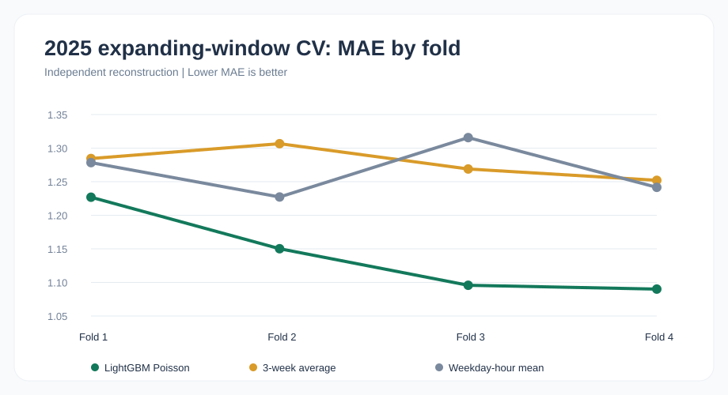
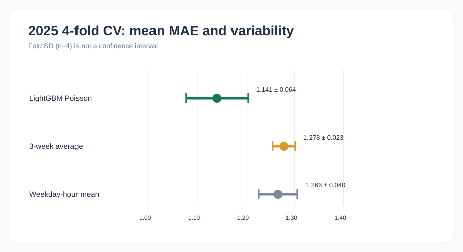
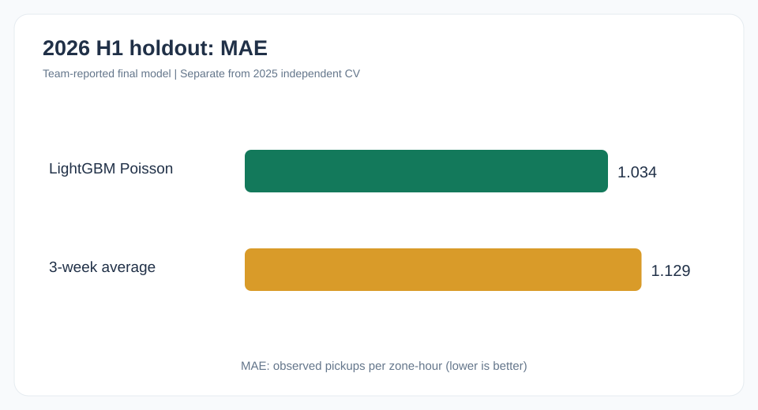
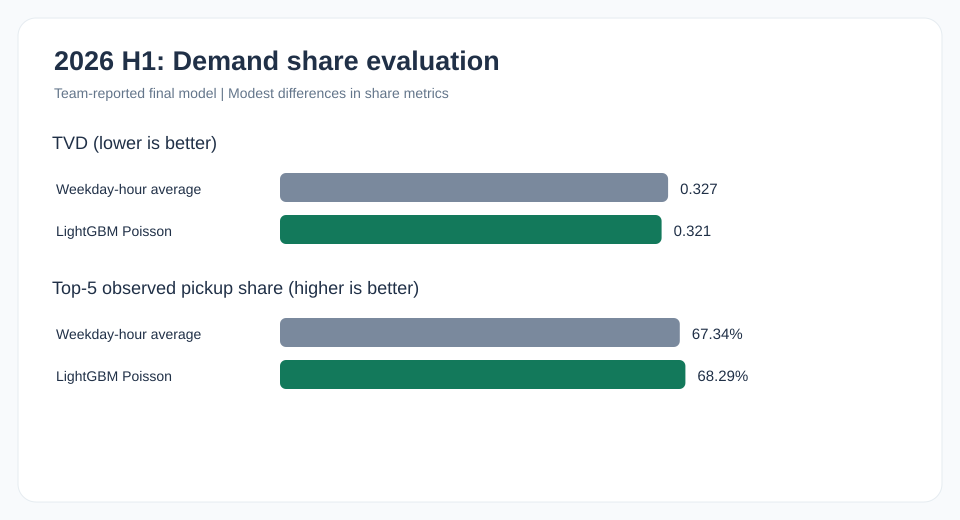

# NYC Green Taxi 모델 성능 검증 보고서

**4Sight 팀 프로젝트 기반 머신러닝 포트폴리오 | Model Evaluation Report**

## 1. 분석 목적

NYC Green Taxi의 과거 운행기록으로 지역별 **다음 1시간의 관측 승차 건수**를 예측하고, 예측 결과가 지역별 승차 비율 비교와 가상 차량 배분 의사결정에 어느 정도 활용될 수 있는지 검토합니다.

분석 대상은 2024년 1월부터 2026년 6월까지의 월별 Parquet 30개입니다. 팀의 데이터 품질 검토에서는 원본 1,506,768건 중 1,501,696건을 유효 승차기록으로 정리했습니다. 미충족 승차 수요나 실제 가용 차량은 이 데이터에 포함되지 않습니다.

## 2. 평가 결과

| 평가 | 지표 | 모델 | 기준선 |
|---|---|---:|---:|
| 2025년 독립 재현 4-Fold | MAE 평균 ± 표준편차 | **1.141 ± 0.064** | 과거 3주 평균 1.278 ± 0.023 |
| 2025년 독립 재현 4-Fold | TVD 평균 | **0.293** | 요일·시간대 평균 0.303 |
| 2026년 팀 최종모형 | MAE | **1.034** | 과거 3주 평균 1.129 |
| 2026년 팀 최종모형 | RMSE | **1.918** | 과거 3주 평균 2.136 |
| 2026년 팀 최종모형 | TVD | **0.321** | 요일·시간대 평균 0.327 |
| 2026년 팀 최종모형 | Top-5 승차 포착 비율 | **68.29%** | 요일·시간대 평균 67.34% |

**주의:** 2025년 4-Fold는 독립 재현이고, 2026년은 팀 최종모형의 보고된 결과입니다. 같은 파이프라인을 동일 조건에서 반복한 것으로 해석하지 않습니다.

## 3. 시계열 교차검증(Time-Series Cross Validation)

2025년의 4개 분기를 각각 검증 기간으로 사용하고, 그 시점까지의 과거 데이터만 학습에 반영하는 **Expanding Window** 방식입니다.

| Fold | 학습 기간 | 검증 기간 |
|---|---|---|
| 1 | 2024년 1~12월 | 2025년 1~3월 |
| 2 | 2024년 1월~2025년 3월 | 2025년 4~6월 |
| 3 | 2024년 1월~2025년 6월 | 2025년 7~9월 |
| 4 | 2024년 1월~2025년 9월 | 2025년 10~12월 |

- 목표 지역은 2024년 정보만으로 선정해 미래 데이터 누수(Data Leakage)를 방지합니다.
- Lag·Rolling Mean·과거 완료 운행 특성 등 예측시점 이전 정보만 입력합니다.
- 비교 기준선은 과거 3주 동일 시간 평균과 요일·시간대 평균입니다.
- 그래프의 오차막대는 Fold 간 표본 표준편차(±1 SD)이며 신뢰구간은 아닙니다.
- 원래 팀의 최종모형 학습 코드와 완전히 일치하는지 확인할 수 없는 독립 구현입니다.





## 4. 2026년 상반기 최종모형 비교

2026년 1~6월은 팀의 최종모형이 보고한 별도 회고 평가 기간입니다.





모델의 MAE는 과거 3주 평균보다 약 8.5% 낮았지만, **TVD와 Top-5 개선 폭은 제한적**입니다. MAE 하나만으로 배분 전략의 효과를 확정할 수 없습니다.

## 5. 오차 및 사례 분석

2026년 6월 1일 07:00 East Harlem North에서는 실제 승차가 **53건**이었지만 모델 예측은 약 **28.5건**이었습니다. 전체 MAE가 낮더라도 특정 혼잡 시간대에는 큰 과소예측이 발생할 수 있음을 보여줍니다. 시간대별 잔차와 지역별 편향을 추가로 검증할 필요가 있습니다.

## 6. 가상 차량 배분과 사업적 해석

2026년 6월 1일 17시 예측 비율을 기반으로 20대 차량을 가상 배분하는 사례에서 East Harlem North는 예측 비율 28.7%로 6대, East Harlem South는 26.3%로 5대가 배정됩니다. 이는 Largest Remainder 방식의 **가상 시나리오**이며 실제 배차 실험은 아닙니다.

팀에서는 이러한 가상 차량 배치 시나리오를 바탕으로 **영업 효율화 의사결정을 지원하는 대시보드와 지도 기반 시각화**를 공동 제작했습니다. 이는 분석 결과를 운영 의사결정에 연결하기 위한 시연용 산출물이며, 실제 현장에서 배차 효율이 개선되었다는 검증 결과는 아닙니다.

이전에 보고된 2,470건의 Coverage Proxy 차이는 실제 추가 승차 2,470건을 뜻하지 않으며, 금액 추정치 역시 실현 수익이 아닙니다.

## 7. 독립 재현 파이프라인: 전처리 → 학습·평가 → 시각화

2025년 **Expanding Window 4-Fold** 성능은 다음 코드를 통해 재현할 수 있습니다. 원본 팀의 2026년 최종모형 구현과는 별도입니다.

| 단계 | 코드 | 결과 |
|---|---|---|
| 1. 전처리·데이터 품질 확인 | [`src/prepare_data.py`](src/prepare_data.py) · [Parquet 보조 리더](src/parquet_min.py) | `data/processed/valid_trips.pkl`, [월별 품질 CSV](reports/metrics/raw_quality_reproduced.csv) |
| 2. LightGBM Poisson 학습·4-Fold 평가 | [`src/run_4fold_cv.py`](src/run_4fold_cv.py) | [Fold별 지표](reports/metrics/2025_4fold_model_scores.csv), [평균·표준편차](reports/metrics/2025_4fold_mean_sd.csv), [실험 설정](reports/metrics/methodology.json) |
| 3. 평가 결과 SVG 시각화 | [`src/visualize_results.py`](src/visualize_results.py) | [SVG 그래프 4개](reports/figures/) |

**실행 방법 (Windows PowerShell · Python 3.10 이상)**

```powershell
git clone https://github.com/areum-hub/nyc-green-taxi-demand-forecasting.git
cd nyc-green-taxi-demand-forecasting
python -m pip install -r requirements.txt

# NYC TLC 원본 2024년 1월 ~ 2025년 12월(24개)을
# data/raw/ 아래 green_tripdata_YYYY-MM.parquet 형식으로 저장
python src/prepare_data.py
python src/run_4fold_cv.py
python src/visualize_results.py
```

- 2026년 1~6월 Parquet 6개를 `data/raw/`에 추가하면 전처리 단계의 **월별 품질 확인**에만 포함되며, **2025년 4-Fold 학습·검증에서는 제외**됩니다. 원본 Parquet 및 전처리 중간 파일은 `.gitignore`로 관리합니다.
- `train_until_exclusive`는 **학습에 포함되지 않는 첫 날짜**입니다. 예를 들어 `2025-01-01`이면 학습은 **2024-12-31까지**, 검증은 **2025-01-01부터**입니다. 같은 날짜가 `validation_from`에 표시되는 것은 정상입니다.
- 2025년 실험에서 LightGBM Poisson **MAE 평균 1.140735**, Fold 간 표준편차 **0.063519**를 재확인했습니다. `Fold SD`는 신뢰구간이 아닙니다.
- `visualize_results.py`는 평가 CSV를 읽어 **외부 그림 파일 없이 SVG 4개를 직접 생성**합니다. 공개된 SVG와 실제 Python 생성 결과가 **바이트 단위로 일치**하는 것을 확인했습니다.
- 2026년 평가 결과 CSV는 **4Sight 팀이 보고한 별도 최종모형 결과**입니다. 현재 공개된 재현 코드는 2026년 최종모형의 원본 학습·평가 파이프라인과 **동일하지 않습니다**.

**기존 평가 자료:** [2026년 팀 보고 결과](reports/metrics/2026_team_holdout_summary.csv) · [East Harlem North 실제·예측 시간별 수치](reports/metrics/2026_east_harlem_north_hourly.csv)

## 8. 한계 및 개선 과제

1. 동일한 학습 파이프라인으로 2025년 교차검증과 2026년 홀드아웃을 다시 수행해야 합니다.
2. 지역별·시간대별 과소예측과 극단적인 승차량 구간의 오차를 별도로 평가해야 합니다.
3. 실제 배분 의사결정에는 택시 가용량, 이동시간, 미충족 수요 등 추가 데이터가 필요합니다.

## 9. 프로젝트 기여도 및 결과 출처

| 구분 | 실제 기여 및 산출물 |
|---|---|
| **개인 기여 — 고아름** | 승차 건수가 0 이상의 건수형 데이터(Count Data)라는 특성을 고려해, 일반 회귀 손실함수 외에 Poisson 목적함수를 활용하는 LightGBM 모델링 방식을 제안하고 모델을 직접 구현했습니다. |
| **4Sight 팀 공동 산출물** | 데이터 전처리·분석 및 최종모형 평가 결과를 바탕으로 **가상 차량 배치 시나리오를 구상**하고, **영업 효율화 의사결정을 지원하는 대시보드와 지도 시각화**를 제작했습니다. 분석 결과와 발표 자료는 팀 공동 산출물로 구분합니다. |


**데이터 출처:** [NYC TLC Trip Record Data](https://www.nyc.gov/site/tlc/about/tlc-trip-record-data.page).
